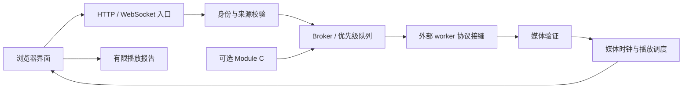

# 架构说明

本仓库保留一个可独立安装的通用框架切片。它用于研究互动请求如何进入队列、生成结果如何通过验证进入播放，以及浏览器如何反馈播放状态。生成模型、GPU 服务、平台账号适配和生产运维不在这个切片内。

## 数据流

图中的 worker 是扩展位置，不是随仓库提供的可运行生成服务。默认没有该连接，因此界面可以加载，音视频生成和直播播放需要额外实现。

## 源码入口与职责

| 入口 | 职责与设计原因 |
| --- | --- |
| `web/server/main.js`、`config.js`、`app.js` | 启动、配置与路由组装。将运行选项集中读取，便于检查启用条件和本地默认行为。 |
| `web/server/auth.js` | 观看 Cookie、worker Bearer、来源校验和限流。不同身份分开判断，避免观看权限自然变成服务端控制权限。 |
| `web/server/broker.js`、`interaction-priority.js` | 请求排队、任务状态、worker / viewer 连接与事件分发。优先级由可信入口赋予，同类请求保持先后顺序。 |
| `web/server/local-*`、`stream-*`、`prepared-clip.js`、`reply-validator*` | 本地及分段媒体的解析、验证、准备和调度。昂贵验证与播放过程分离，减少不可信媒体和耗时解析对共享调度的影响。 |
| `web/server/media-metrics.js`、`playback-reports.js` | 媒体计数与浏览器报告。报告只接受确定字段并限制容量和保留时长，避免诊断数据无限增长。 |
| `web/server/module-c/` | 订单、定价、验证、存储及互动投递。支付确认与实际互动完成分为不同状态，以表达确认延迟、重试和投递不确定性。 |
| `web/public/` | 页面、播放器、缓冲与可见性状态。浏览器负责真实播放进度，服务端收到数据不能等同于观众已听到内容。 |
| `web/test/` | 可独立执行的合同测试。它们覆盖分享切片的关键行为，不代表原项目全部功能或生产验收。 |

## 调度、时钟与故障边界

互动优先级区分已验证的付费留言、普通互动和自主内容；同一类保持 FIFO。支付金额可以影响权益时长，但不用于跳过更早的同类请求。这个安排让调度顺序和展示权益分别建模。

生成准备、媒体接收、服务端播放和浏览器播放分别记录状态与时间。片段进入缓冲只说明数据可用，真正的播放进度还取决于时间戳、缓冲和浏览器行为。时钟与状态分离使延迟定位有明确的阶段边界。

慢连接的待发送字节超过上限时，Broker 结束该连接并允许重新连接；原因是单个观众不能让共享媒体泵持续积压。片段验证有独立的大小、轨道和时间合同；原因是不符合合同的数据不能仅凭发送方声明进入播放。

## 扩展接缝

| 接缝 | 如何研究与接入，以及原因 |
| --- | --- |
| 内容生成 | 从 `broker.js` 的 worker 消息与媒体验证代码阅读协议，先接内存假实现或测试片段；原因是仓库不含生成服务，接口还包含生命周期与媒体合同。 |
| 新互动来源 | 复用可信入口验证，再调用 Broker 提交方法；原因是来源、去重和优先级不应由观看页面任意声明。 |
| 播放诊断 | 扩展明确的数字、枚举或布尔字段并保持容量与有效期；原因是报告收集器用于定位播放问题，不用于接收自由文本或私人身份。 |
| 付费互动 | 先通过 Module C 的可注入验证器、时钟与存储接口做隔离测试；原因是订单确认、权益开始和投递完成是独立阶段，真实交易不能替代合同测试。 |

这些扩展点描述技术边界，不提供部署地址、SSH 操作、密钥、生产媒体或生产状态恢复流程。本快照的源码和测试结果应按自身范围理解；原因是裁剪后的框架没有包含完整业务集成与线上运行环境。
