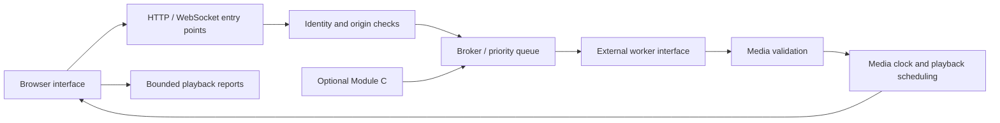

# Architecture

This repository is an independently installable slice of a general-purpose framework. It shows how interaction requests enter a queue, generated results pass validation and reach playback, and browsers report playback state. Generation models, GPU services, platform account integrations, and production operations are outside its scope.

## Data flow

The worker in this diagram is an extension interface, rather than a generation service bundled with the repository. Without an external worker, the interface loads, but audio/video generation and live playback require an additional implementation.

## Source entry points and responsibilities

| Entry point | Responsibility and design rationale |
| --- | --- |
| `web/server/main.js`, `config.js`, `app.js` | Startup, configuration, and route assembly. Centralized configuration makes feature gates and local defaults easier to inspect. |
| `web/server/auth.js` | Viewer cookies, worker bearer tokens, origin checks, and rate limits. Separate identity checks prevent viewing access from granting server control. |
| `web/server/broker.js`, `interaction-priority.js` | Request queues, job states, worker/viewer connections, and event dispatch. Trusted entry points assign priority; requests within a class retain their arrival order. |
| `web/server/local-*`, `stream-*`, `prepared-clip.js`, `reply-validator*` | Parsing, validation, preparation, and scheduling for local and segmented media. Separating expensive validation from playback reduces the impact of untrusted media and slow parsing on shared scheduling. |
| `web/server/media-metrics.js`, `playback-reports.js` | Media counters and browser reports. Accepted fields, capacity, and retention are bounded to prevent diagnostic data from growing indefinitely. |
| `web/server/module-c/` | Orders, pricing, verification, storage, and interaction delivery. Payment confirmation and interaction completion have separate states to represent confirmation delays, retries, and uncertain delivery. |
| `web/public/` | Pages, players, buffering, and visibility state. Browsers track actual playback progress; receiving data at the server does not prove that a viewer has heard it. |
| `web/test/` | Independently runnable contract tests. They cover key behavior in this public snapshot rather than the original project's complete feature set or production acceptance criteria. |

## Scheduling, clocks, and failure boundaries

Interaction priority distinguishes verified paid messages, regular interactions, and autonomous content. Each class follows FIFO order. Payment amounts can affect entitlement duration, but do not bypass earlier requests in the same class, keeping queue order separate from display entitlements.

Generation preparation, media reception, server playout, and browser playback each record their own states and timestamps. A buffered fragment only establishes data availability; actual playback also depends on timestamps, buffering, and browser behavior. Separate clocks and states provide clear boundaries for locating latency.

When a slow connection's pending bytes exceed the limit, the Broker closes that connection and allows reconnection so one viewer cannot indefinitely back up the shared media pump. Fragment validation independently checks size, tracks, and timing, because a sender's declaration alone cannot establish that media is safe to play.

## Extension interfaces

| Interface | How to extend it, and why |
| --- | --- |
| Content generation | Read the worker messages in `broker.js` and the media validation code, then start with an in-memory stub or test fragments. The repository has no bundled generation service, and its interface includes lifecycle and media contracts. |
| New interaction sources | Reuse trusted-entry validation before calling Broker submission methods. The viewing page should not be able to assign its own origin, deduplication rules, or priority. |
| Playback diagnostics | Add explicit numeric, enum, or boolean fields while preserving capacity and expiry bounds. The collector diagnoses playback issues rather than accepting free text or personal identities. |
| Paid interactions | Start with isolated tests using Module C's injectable verifiers, clocks, and storage interfaces. Order confirmation, entitlement start, and delivery completion are separate stages; real transactions cannot replace contract tests. |

These interfaces describe technical boundaries. They do not provide deployment addresses, SSH instructions, keys, production media, or production recovery procedures. Interpret this snapshot's source and test results within its own scope, because the extracted framework does not include the complete business integration or production runtime.
